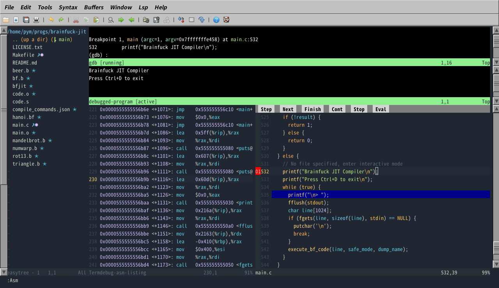

# Vim 9 搭建 C/C++ 开发环境

本文将介绍如何使用 Vim 9 搭建 C/C++ 开发环境，包括配置文件、插件和快捷键等。本文内容仅适用于 Vim 9.0+，不适用于旧版本 Vim 和 Neovim。

## 为什么不直接用 XXX 编辑器/IDE？

- 开销大
- 启动速度慢
- 可自定义程度不如 Vim
- 我是 Vim 党

## 为什么不用 Neovim？

网上能看到很多折腾 Neovim 的教程，而关于 Vim 的却较少。但实际上，Neovim 能做到的 Vim 基本也都能。而且 Neovim 更慢也更 buggy。

## 基础配置

在 Linux 上，发行版很有可能已经做好了基础配置，但为确保行为一致，还是手动配置一下。

编辑 `.vimrc`：

```viml
" 关闭 Vi 兼容模式
set nocompatible
" 开启行号
set number
" 设置退格键可删除自动缩进、换行符、插入开始位置
set backspace=indent,eol,start
" 开启自动缩进
set autoindent
set smartindent
" 开启文件类型侦测
filetype plugin indent on
" 开启语法高亮
syntax on
" 设置智能大小写
" 若搜索模式全为小写，则忽略大小写；否则匹配大小写
set ignorecase smartcase
" 将缩进宽度设为 2
set tabstop=2
set shiftwidth=2
" 自动展开 Tab 键为空格
set expandtab
" 高亮光标所在行
set cursorline
" 在命令模式按 Tab 键时，显示补全菜单
set wildmenu
" 高亮搜索结果
set hlsearch
" 按空格键时取消高亮
nnoremap <Space> :nohlsearch<CR>
```

## 添加 LSP 插件

最好的 C/C++ LSP 服务器毫无疑问当数 Clangd。安装它：

```bash
# 替换为你的发行版的命令
sudo apk add clang22-extra-tools
```

Windows 用户可以选择使用 [LLVM Installer](https://github.com/llvm/llvm-project/releases/latest) 或 [standalone](https://github.com/clangd/clangd/releases/latest) 版本。

安装 Vim 的 LSP 插件：

```bash
git clone https://github.com/yegappan/lsp.git ~/.vim/pack/downloads/opt/lsp
```

Windows 用户需将此处及之后的所有 `~/.vim/` 替换为 `%USERPROFILE%/vimfiles/`

编辑 `.vimrc`，加入以下内容：

```viml
packadd lsp
call LspAddServer([#{
  \  name: 'clangd',
  \  filetype: ['c', 'cpp'],
  \  path: '/usr/bin/clangd',
  \  args: ['--background-index', '--clang-tidy'],
  \}])
```

此时打开一个源文件，随便输入一些内容，即可看到自动补全提示。默认键位是按 Ctrl-Y 接受建议。还有一些常用命令：

- `:LspGotoDeclaration`，`:LspPeekDeclaration`：跳转到/查看声明
- `:LspGotoDefinition`，`:LspPeekDefinition`：跳转到/查看定义
- `:LspDiagCurrent`：查看当前行的诊断信息
- `:LspShowReferences`：查看引用
- `:LspRename`：重命名符号
- `:LspSymbolSearch`：查找并跳转到符号
- `:LspOutline`：查看符号表
- `:LspFormat`：格式化当前文件

直接敲这些命令很费劲，可以根据自己的喜好设置快捷键，例如，在 `.vimrc` 中添加：

```viml
" 查看声明
nnoremap <leader>pd :LspPeekDeclaration<CR>
```

之后按 `\pd` 就可以查看当前光标所在的符号的声明了。

## Clangd 的使用

直接打开一个项目中的文件，你大概率会看到大片标红，这是因为 Clangd 找不到代码中引入的头文件。需要创建一个名为 `compile_commands.json` 的文件，告知 Clangd 编译时使用的参数。它的内容大概是这样的：

```json
[
  {
    "file": "main.cpp",
    "arguments": [
      "/usr/bin/g++",
      "main.cpp",
      "-I<头文件路径>",
      "-std=c++17",
      "-Wall",
      "-Wextra",
      "-Wpedantic",
      "-g",
      "-c",
      "-o",
      "main.o"
    ],
    "directory": "<项目根目录>",
    "output": "main.o"
  }
]
```

但是这样手动维护太麻烦了，当然也有自动生成 `compile_commands.json` 的方法。

### 使用 CMake

对于使用 CMake 构建的项目，只需执行以下命令：

```bash
cmake . -DCMAKE_EXPORT_COMPILE_COMMANDS=1
```

### 使用 Bear

对于使用其他构建系统，例如手写 Makefile 的项目，可以使用 Bear。它通过记录一次完整的构建来生成 `compile_commands.json`。安装 Bear：

```bash
sudo apk add bear
```

执行以下命令即可生成 `compile_commands.json` 文件：

```bash
# 删除已经存在的文件
make clean
bear -- make
```

## 进一步配置

### 启用语义化高亮

在 `.vimrc` 中添加：

```viml
call LspOptionsSet(#{
  \  semanticHighlight: v:true,
  \})
```

启用前各种符号都是白色，现在它们会按类型（函数、变量、类等）进行高亮。

### 使用 Tab 键接受自动补全

在 `.vimrc` 中添加：

```viml
inoremap <expr> <Tab> pumvisible() ? "<C-y>" : "<Tab>"
```

按 Tab 时，会调用 `pumvisible` 函数判断自动补全菜单是否可见。如果可见，则接受自动补全（`<C-y>`），否则就是普通的 Tab 键。

### Clang-Tidy

Clang-Tidy 是一个静态代码风格检查器（linter），已集成在 Clangd 中。Clang-Tidy 提供的检查大致有以下几类：

- `bugprone-*`：容易导致 bug 的代码模式
- `modernize-*`：可以改用现代 C++ 的语法
- `performance-*`：性能优化建议
- `readability-*`：可读性建议

要启用 Clang-Tidy，在项目根目录中创建 `.clangd` 文件，写入：

```yaml
Diagnostics:
  ClangTidy:
    Add: [bugprone-*, modernize-*, performance-*, readability-*]
```

Clang-Tidy 的 `modernize-*` 检查会建议使用尾随返回类型，也就是将 `int fn()` 写成 `auto fn() -> int`。虽然我支持使用现代 C++ 语法，但这实在有些过分了，可以单独关闭这个检查项：

```yaml
Diagnostics:
  ClangTidy:
    Add: [bugprone-*, modernize-*, performance-*, readability-*]
    Remove: modernize-use-trailing-return-type
```

## 其他插件

### 侧边栏文件树

安装 easytree（这个插件需要 Vim 有 Python 支持）：

```bash
git clone https://github.com/troydm/easytree.vim.git ~/.vim/pack/downloads/opt/easytree.vim
```

在 `.vimrc` 中添加:

```viml
packadd easytree.vim
" 进入 Vim 后自动打开文件树
autocmd VimEnter * EasyTree
```

打开任意文件后，就可以看到侧边栏文件树了。使用 Ctrl-W 系列快捷键可以关闭文件树，以及在文件树和编辑器之间切换。在文件树中，可以使用 `y`、`d`、`p` 等快捷键复制、剪切和粘贴文件。按 `R` 可刷新文件树，按 `I` 可切换是否显示隐藏文件。文件树中还会显示文件的 Git 状态（新增、修改等）。如果符号没有正确显示，说明需要安装 Nerd Fonts。

### 注释

tcomment 为多种编程语言提供了切换注释功能。安装它：

```bash
git clone https://github.com/tomtom/tcomment_vim.git ~/.vim/pack/downloads/start/tcomment_vim
```

注意这里是 `start` 不是 `opt`。

安装好后就可以直接使用了。基本用法是在正常模式下按 `gcc` 切换当前行的注释，在可视模式下选中区域后按 `gc` 切换注释。

### 终端集成

好像很多人还不知道，Vim 已经有内置终端了。使用命令 `:term [<要运行的程序>]` 即可打开，如果没有指定要运行的程序，则打开 shell。

与编辑器一样，内置终端也有插入模式和正常模式的区别。打开后默认处于插入模式，按 Ctrl-\\, Ctrl-N 可切换到正常模式，再按 `i` 可切换到插入模式。

如果对内置终端不满意，可以试试这个插件：[Floaterm](https://github.com/voldikss/vim-floaterm)。它提供了非常强大的终端管理功能，以及与其他插件的集成。只是它使用起来较为复杂，感兴趣的话自己去读 README 吧。

### GDB 集成

Vim 自带 Termdebug 插件，无需安装，只需在 `~/.vimrc` 中添加：

```viml
packadd! termdebug
```

注意 `packadd` 后面的感叹号，并且 `termdebug` 是全小写。

使用 `:Termdebug <调试目标>` 可打开调试器。打开调试器后会新出现两个窗口：一个是 GDB 控制台，一个是程序输出。源码窗口中也会出现 `Step`、`Next`、`Continue` 等按钮。

该插件还提供了以下命令：

- `:Break`：在光标位置设置断点。源码窗口中对应行左侧会出现断点标记
- `:Clear`：清除光标位置的断点
- `:ToggleBreak`：如果光标位置没有断点，则设置断点，否则清除断点
- `:Asm`：显示反汇编窗口
- `:Var`：显示局部变量和参数窗口

更多用法可以使用 `:help Termdebug` 查看。

### 主题

可以在 [Vimcolorschemes](https://vimcolorschemes.com/) 浏览主题。

下面以我最喜欢的主题 Ayu 为例，演示如何安装主题。

首先克隆仓库：

```bash
git clone https://github.com/ayu-theme/ayu-vim.git ~/.vim/pack/colorschemes/opt/ayu-vim
```

再在 `~/.vimrc` 中添加：

```viml
" 开启终端真彩色
set termguicolors
" Ayu 主题特有的设置
let ayucolor = 'mirage'
colorscheme ayu
```

## 成果

现在我们有了一个功能完备的 C/C++ 开发环境。经我实测，编辑一个普通的 C 文件时，Vim + Clangd 内存占用总计仅 70MB。而 VS Code，光是打开一个空窗口就已经有 1GB。

再附上一张截图：



## 杂七杂八

我觉得 Vim 最大的魅力就在于极高的可自定义性。如果有什么不满意的，自己改就好了。通过各种插件的组合，可以实现不亚于 IDE 的效果。Vim 支持将多个命令结合，以及允许调用外部工具来进行复杂的文本处理等，也很符合 Unix 哲学。正常与插入模式的区别虽然对新手不友好，但对熟练用户来说能显著提高效率，无需伸长手指去按 Ctrl、Alt，只用字母键就能实现各种复杂的操作。自从学会 Vim，我就再也不会用 Emacs、Nano 之流了。如果你还没有皈依 Vim 神教，现在也为时不晚。
